  
   
   
  <h1>Nosfeik</h1>
  

    <strong>Emmanuel Aguilar Montaño</strong> 
    Ingeniero en Redes Inteligentes y Ciberseguridad · Pentesting · Linux · Redes 
    Escribiendo contenido técnico en español en <a href="https://Nosfeik.com/">Nosfeik.com</a>
  

  
  
  

  
  

## Sobre mí

- Soy Emmanuel Aguilar Montaño, ingeniero en redes inteligentes y ciberseguridad.
- Comparto contenido técnico en español sobre pentesting, Linux, redes, TTYs y automatización.
- Mi entorno favorito gira alrededor de Arch Linux, Hyprland y `zsh`.

## Posts destacados

<table align="center">
  <thead>
    <tr>
      <th>Post</th>
      <th>Enfoque</th>
    </tr>
  </thead>
  <tbody>
    <tr>
      <td><a href="https://Nosfeik.com/posts/dotfiles/">Mis dotfiles</a></td>
      <td>Personalización, terminal y entorno de trabajo</td>
    </tr>
    <tr>
      <td><a href="https://Nosfeik.com/posts/full-tty/">Tratamiento de la TTY</a></td>
      <td>Estabilización de shells y post-explotación</td>
    </tr>
    <tr>
      <td><a href="https://Nosfeik.com/posts/nmap-service-enumeration/">Nmap - Enumeración de Servicios</a></td>
      <td>Reconocimiento y enumeración de servicios</td>
    </tr>
    <tr>
      <td><a href="https://Nosfeik.com/posts/nmap-firewall-ids-ips-evasion/">Nmap - Firewall IDS/IPS Evasion</a></td>
      <td>Evasión y escaneo más sigiloso</td>
    </tr>
    <tr>
      <td><a href="https://Nosfeik.com/posts/ansible/">Controla Servidores Ubuntu con Ansible y Playbooks</a></td>
      <td>Automatización operativa y administración</td>
    </tr>
  </tbody>
</table>

## Actividad en GitHub

 
  

